# YVtils Collection

This repository combines all the yvtils minecraft plugins in one place, for easier access and management.

## Breaking release

This release introduces a new launcher and configuration/runtime architecture. It is
installed as a fresh deployment; legacy plugin data, permissions and APIs are not
supported upgrade inputs. See [installation and release verification](docs/breaking-release.md).

Requires Java 25 and Paper **26.1.2, 26.2 or 26.3**. Install the core JAR, start once,
then enable desired modules in `plugins/yvtils/modules.yml` and restart.

## For contributors

- Creating a new feature module? See
  [docs/adding-a-new-module.md](./docs/adding-a-new-module.md).
- Migrating an existing module or core to the new dynamic module system? See
  [docs/migrating-to-dynamic-modules.md](./docs/migrating-to-dynamic-modules.md).

## Plugins included in this collection

- One [core launcher](core/) with selectable feature libraries.
- Discord integration, MultiMine, WorldGuard-backed Regions, Essentials,
  Moderation, Fusion, Sit, Status, Message, Server, Stats, Metrics, Vanish and Waypoints.
- Optional YV SMP cinematics/music/ambient sounds and Remade Ender Dragon.

The old standalone plugin launchers are retired. Their Modrinth pages and older
repository branches describe previous products rather than installable artifacts
for this release.

---

## Modules in this Collection

### Remade Ender Dragon

Player-scaled dragon encounters with configurable attacks, team support, and
admin previews. See [the module guide](docs/remade-ender-dragon.md).

Each module README describes features, settings, structure and verification:

[Core](core/README.md) · [Common](common/README.md) · [Config](config/README.md) ·
[Utils](utils/README.md) · [Discord](discord/README.md) · [Essentials](essentials/README.md) ·
[Fusion](fusion/README.md) · [Moderation](moderation/README.md) · [MultiMine](multiMine/README.md) ·
[Regions](regions/README.md) · [Server](server/README.md) · [Sit](sit/README.md) ·
[Stats](stats/README.md) · [Metrics](metrics/README.md) · [Status](status/README.md) · [Message](message/README.md) ·
[Vanish](vanish/README.md) · [Waypoints](waypoint/README.md) · [YV SMP](yv-smp/README.md) ·
[Remade Ender Dragon](remade-ender-dragon/README.md).

GUI libraries: [26.1 shared source](gui-26.1/README.md), [26.2](gui-26.2/README.md),
[26.3](gui-26.3/README.md). Historical launcher directories have retirement notices.

---

- Translations: [Crowdin](https://crowdin.com/project/yvtils-collection)

- Trailer: [Chapter Two Trailer](https://youtu.be/gQi54Pd_SWE)

# Modules

## Discord Module

- Tutorial: [Discord Module Setup Guide](https://youtu.be/YQiYSjEcdMk)

- Chat Sync

  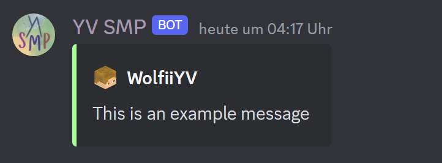
- Minecraft Server Stats

  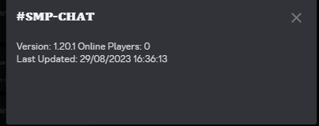
  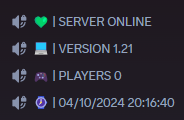
- Console Sync

  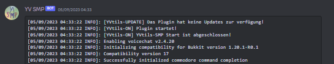
- Whitelist with Discord

## Status Module

`/status set <status>`
`/status default <status>`
`/status clear [player]`

Let players set a status before their name.

## Sit Module

`/sit`

Let players sit down everywhere.

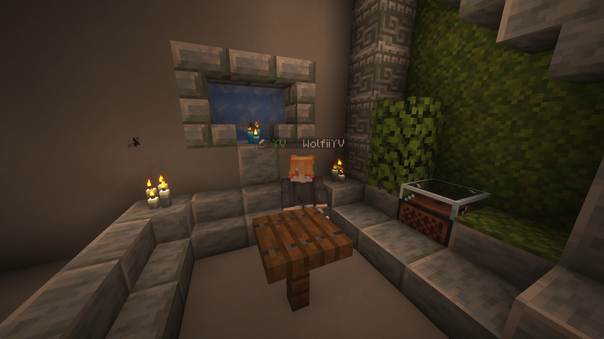

## Extended Vanish Module

`/vanish [layer]`

Current commands: `/vanish` (`/v`) toggles layer 1; `/vanish <1-100>` toggles a
staff layer. Permissions: `yvtils.vanish.use`, `yvtils.vanish.layers` (OP by
default). Silent container inspection uses a detached, read-only snapshot.

- Silent Container Interaction
- No Mob Targeting
- Ignore dropped items
- Layer System
    - Higher Layer Players can see Lower Layer Players, but not vice versa.

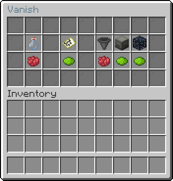

## Moderation Module

- Ban Command `/ban <player> [reason]`
- Tempban Command `/tempban <player> <time> <unit> [reason]`
- Kick Command `/kick <player> [reason]`
- Mute Command `/mute <player> [reason]`
- Tempmute Command `/tempmute <player> <time> <unit> [reason]`
- Unban Command `/unban <player>`
- Unmute Command `/unmute <player>`
- Warn Command `/warn <player> [reason]`
- Moderation GUI `/modgui [player-name-or-UUID]`
    - Paginated online/offline player selection and name/UUID search
    - Ban, tempban, kick, mute, tempmute, warn, unban and unmute using existing action permissions
    - Anvil reason/duration input, confirmation, current mute/ban status and warning history
    - Requires `yvtils.moderation.command.modgui` plus the permission for each action

See [essentials/moderation settings and verification](docs/moderation-and-essentials.md).

## Fusion Module / Custom Crafting

The collection now includes the dynamic Fusion module. See
[Fusion setup, recipe schema and verification](fusion/README.md) and the
[future recipe ideas](fusion/RECIPE_IDEAS.md).

`/fusion [manage]`

- Let players craft custom items
    - Invisible Item Frames

      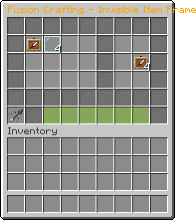

    - Light Blocks

      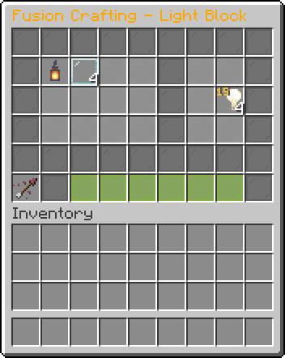

    - Custom Player Heads

      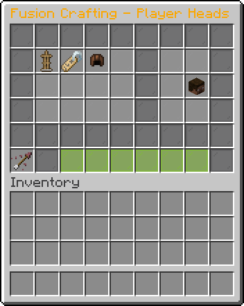

- Manage existing or create new fusions

  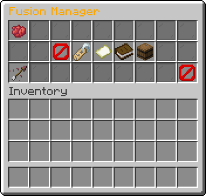

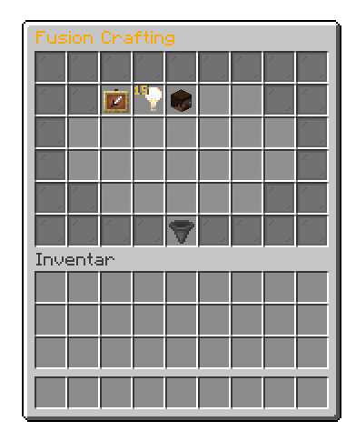

## MultiMine Module (VeinMiner & Timber)

`/mm add [block]`
`/mm addMultiple`
`/mm remove [block]`
`/mm removeMultiple`

- MultiMine Blocks
- Add/Remove multiple blocks at once with a container in your hand

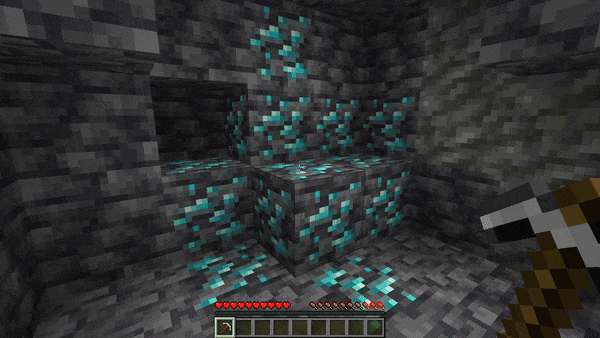
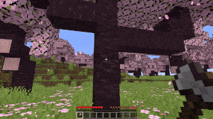

## Server Module

- Maintenance Mode
- Custom MOTD

  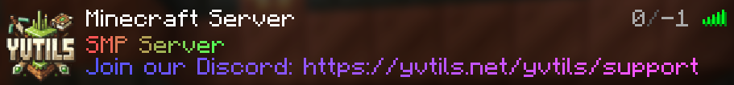
- Fake Max Player Count
- Customizable Player Info Text

  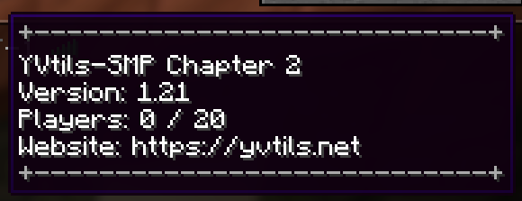

## Waypoints Module

`/waypoint create <name> [public/private/unlisted]`
`/waypoint navigate <name>`
`/waypoint delete <name>`
`/waypoint list`
`/waypoint stop`
`/waypoint` — player management GUI
`/waypoint manage` — administrator management GUI
`/waypoint config` — module settings GUI

`/wp` is an alias. Creation defaults to private. Names are globally unique,
case-insensitive, and contain 1–64 letters, digits, `_` or `-`. Navigation uses
private glowing block displays and action-bar direction/distance in the destination world.
Permissions: `yvtils.waypoint.use`, `yvtils.waypoint.create`, and
`yvtils.waypoint.admin` (delete another owner's public/unlisted waypoint).
These permissions default to OP unless granted explicitly.

- Create waypoints with visibilities
    - Public - Everyone can see it
    - Private - Only you can see it
    - Unlisted - Only you can see it, but others can navigate to it
- Navigate to waypoints

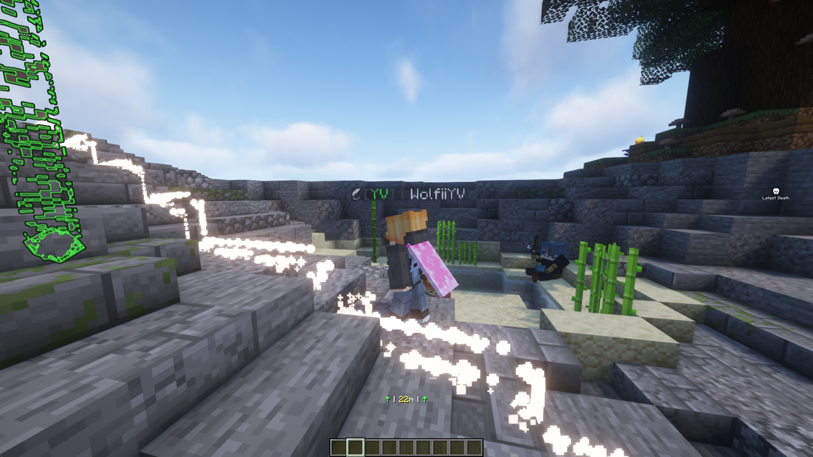

## Other Features

- Anti Too Expensive
    - Bypasses the "Too Expensive" Enchantment Limit
    - `essentials` setting `disableTooExpensive: true` (default); normal XP costs and enchantment-level limits still apply.

  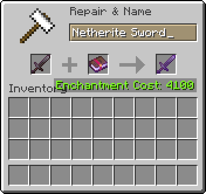

- MSG System
    - `/msg <player> <message>`
    - `/r <message>`

  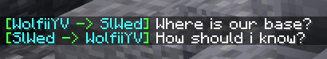

- Spawn Elytra
    - Optional `essentials` feature: double-jump near spawn to glide without an Elytra;
      use the swap-offhand key for one boost per flight.
    - Enable with `spawnElytra.enabled: true` in `plugins/yvtils/essentials/config.yml`.
      Configure `worlds` (default `[world]`), `radius` (default `100.0`, 3D distance),
      and `boostStrength` (default `2.0`) under `spawnElytra`, then restart.
    - Survival only; protects against fall/wall damage during the flight and respects `/fly`.

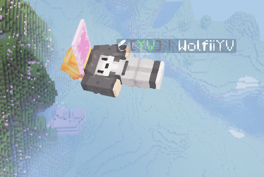

# Commands

- Online/offline inventory inspection `/invsee <known-name-or-UUID>`
  (`yvtils.essentials.command.invsee`)
- Online/offline ender-chest inspection `/ecsee <known-name-or-UUID>`
  (`yvtils.essentials.command.ecsee`)
  Add `.edit` to either permission to exchange a target slot with your cursor.
  Online views refresh live; offline exchanges save immediately. See
  [inventory administration](essentials/README.md#inventory-administration).

- Fly Command `/fly [player]`
- Heal Command `/heal [player]`
- Speed Command `/speed <speed> [player]`
- God Command `/god [player]`
- GlobalMute Command `/gmute [state]`
- Gamemode Command `/gm <gamemode> [player]`
- Seed Command `/seed show`

# Other

## Chat colors

Set `allowChatColors: false` in `plugins/yvtils/essentials/config.yml` and restart
to use Paper's normal chat rendering without parsing player MiniMessage tags.
The default is `true`. Color-enabled chat retains Paper's audiences and event
cancellation, including moderation mutes.

## Smart Language System

[Discord](https://discord.gg/qHpMsduU7p)
